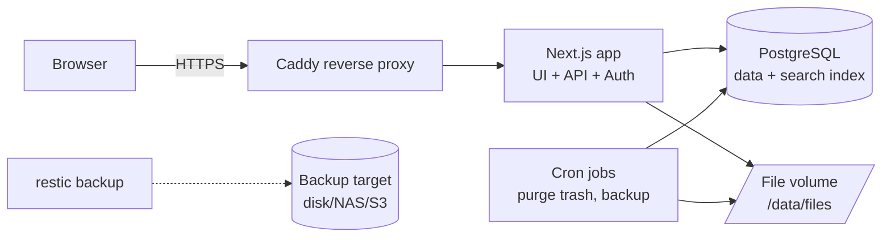
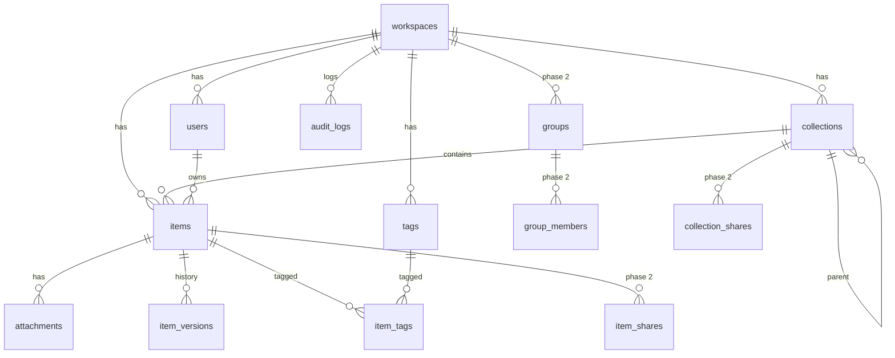

# Dev Inventory — System Design

> สถานะ: Draft v1.3 · วันที่ 2026-11-05
> v1.3: **D22** รายการทุกชิ้นเป็น Note ชนิดเดียว เนื้อหาเป็น Markdown ทั้งหมด ประเภทเดิมกลายเป็น "ป้าย" (kinds) เลือกได้หลายป้าย ไฟล์แนบอยู่ใต้ Note (§3, §6, §8, §12, §13, §17)
> v1.2: เพิ่ม dialog เชิญด้วยอีเมล / โอนความเป็นเจ้าของ ใน §13.1
> v1.1: เพิ่มรายละเอียดหน้า Login / SetPassword / Admin (§13.1), ออกแบบรองรับ Login ด้วย Google ในเฟส 2 (§19, D16–D20) และเตรียมจุดเชื่อมไว้ในเฟส 1
> UI mockup + สเปกหน้าจอ: ดู `ui-design.md`
> ขอบเขตเอกสาร: ออกแบบทั้งระบบ เน้นรายละเอียดของเฟส 1 (MVP) และเตรียม data model ให้รองรับเฟส 2–3

---

## 1. ภาพรวม

### 1.1 เป้าหมาย
คลังความรู้ภายในทีมพัฒนาสำหรับเก็บ source code, snippet, script, เอกสาร, note ของโปรเจกต์ และลิงก์อ้างอิง โดย **ค้นหาได้เร็วด้วย keyword หรือข้อความสั้นๆ** ทั้งภาษาไทยและอังกฤษ และควบคุมได้ว่าใครเห็นหรือแก้ไขอะไรได้

### 1.2 ผู้ใช้และขนาดระบบ
- ทีมเดียว ไม่เกิน 10 คนในช่วงแรก
- อนาคตอาจเปิดให้ทีมอื่นใช้ โดยแยกเป็น **Workspace** ของตัวเอง **ไม่มีการแชร์ข้าม Workspace**
- ผู้ใช้ 1 คนอยู่ได้ 1 Workspace เท่านั้น

### 1.3 หลักการออกแบบ
1. **Open source + ฟรี** รันบนเครื่องเดียวได้ และขยายได้เมื่อมีงบ
2. **ค้นหาเป็นหัวใจของระบบ** ค้นภาษาไทยที่ไม่มีช่องว่างได้ ค้นชื่อใน code ได้ และผลค้นหาไม่ทำให้ข้อมูลรั่ว
3. **ตรวจสิทธิ์ที่ server ทุกครั้ง** ไม่เชื่อ client
4. **เฟส 1 ให้เล็กที่สุดที่ใช้งานจริงได้** แต่ data model รองรับเฟสถัดไปไว้แล้ว

---

## 2. สรุปการตัดสินใจ (Decision Log)

| # | หัวข้อ | การตัดสินใจ |
|---|---|---|
| D1 | การเข้าถึงโดยไม่ login | **ไม่มี** ทุกคนต้อง login และระบบไม่มีระดับ Public หรือลิงก์สาธารณะ |
| D2 | Workspace | data model เป็น multi-workspace ตั้งแต่แรก เฟส 1 เปิดใช้ 1 Workspace ไม่มีการแชร์ข้าม Workspace |
| D3 | บทบาท | Super Admin (ระดับระบบ), Workspace Admin, Member ไม่มีบทบาท Viewer เพราะเจ้าของเนื้อหากำหนดสิทธิ์ดูหรือแก้ไขเอง |
| D4 | ระดับการเข้าถึง เฟส 1 | 🔒 ส่วนตัว / 👥 Workspace ดูได้ / ✏️ Workspace แก้ไขได้ |
| D5 | ระดับการเข้าถึง เฟส 2 | 👤 เพิ่มการแชร์รายบุคคลหรือรายกลุ่ม (ดูได้ / แก้ไขได้) + Share dialog + ปุ่มขอสิทธิ์ |
| D6 | Admin กับเนื้อหาส่วนตัว | Admin เห็นได้แค่ **metadata** (ชื่อเรื่อง เจ้าของ วันที่) ในหน้า Admin เท่านั้น เปิดเนื้อหาหรือไฟล์แนบไม่ได้ และชื่อเรื่องไม่ขึ้นในผลค้นหาของ Admin |
| D7 | หมวดหมู่ / โปรเจกต์ | รวมเป็นสิ่งเดียวเรียกว่า **Collection** ซ้อนได้ไม่เกิน 3 ชั้น และใช้ tag ช่วยจัดกลุ่มเพิ่ม |
| D8 | สร้าง Collection | สมาชิกทุกคนสร้างได้ Collection มีสิทธิ์แบบเดียวกับรายการ และเป็นค่าเริ่มต้นให้รายการข้างใน |
| D9 | สิทธิ์ "แก้ไขได้" | แก้ได้เฉพาะเนื้อหา การลบ ย้าย และเปลี่ยนสิทธิ์ทำได้เฉพาะเจ้าของกับ Admin |
| D10 | ประวัติการแก้ไข | อยู่ในเฟส 1 พร้อมป้องกันการเขียนทับเมื่อแก้พร้อมกัน (optimistic locking) |
| D11 | บัญชีผู้ใช้ | **เชิญด้วยอีเมลเท่านั้น** ไม่มีหน้าสมัครสมาชิก และไม่มีการสร้างบัญชีโดยไม่มีคำเชิญ (ดู D21) Admin copy ลิงก์เชิญไปส่งเอง และเป็นคน reset รหัสผ่าน จึงไม่ต้องใช้ SMTP ในเฟส 1 |
| D12 | Login | เฟส 1: **อีเมล** + password · เฟส 2: Google (รายละเอียด §19) |
| D13 | ค้นในไฟล์แนบ | ไม่ทำในเฟส 1 ย้ายไปเฟส 3 |
| D14 | ภาษา / ขนาดไฟล์ | หน้าจอภาษาไทยและรองรับ i18n · ไฟล์ไม่เกิน 50 MB ต่อไฟล์ |
| D15 | ค่าเริ่มต้นของ Collection ใหม่ระดับบนสุด | 👥 Workspace ดูได้ (Admin เปลี่ยนค่าเริ่มต้นได้) รายการใหม่สืบทอดจาก Collection |
| D16 | Google login ไม่เปิดสมัครเอง | Google ใช้ **เข้าสู่ระบบกับบัญชีที่ Admin เชิญไว้แล้วเท่านั้น** ไม่สร้างผู้ใช้ใหม่จากการ login ด้วย Google (`disableSignUp`) |
| D17 | การจับคู่บัญชี Google | จับคู่ครั้งแรกด้วยอีเมลที่ Google ยืนยันแล้ว (`email_verified = true`) กับ `users.email` แล้วผูกด้วย Google `sub` ซึ่งเป็นตัวอ้างอิงถาวร หลังผูกแล้วไม่ใช้อีเมลจับคู่อีก |
| D18 | วิธี login ตั้งระดับ Workspace | Admin เปิด/ปิดรหัสผ่านและ Google ได้ใน Admin › ตั้งค่า จำกัดโดเมนอีเมลได้ ต้องเปิดอย่างน้อย 1 วิธี |
| D19 | ทางหนีไฟ (break-glass) | ต้องมี Workspace Admin อย่างน้อย 1 คนที่ใช้รหัสผ่านได้เสมอ ระบบไม่ยอมให้ปิดวิธีสุดท้ายของผู้ใช้ หรือปิดรหัสผ่านของ Admin คนสุดท้าย |
| D20 | เตรียมไว้ในเฟส 1 | สร้างคอลัมน์ตั้งค่า login method, ใช้ตาราง `account` ของ Better Auth, หน้า Login อ่านปุ่มจาก `/auth/methods`, audit log เก็บ `method` ไว้ตั้งแต่เฟส 1 เพื่อให้เฟส 2 ไม่ต้อง migrate ข้อมูลเดิม |
| D21 | อีเมลเป็นตัวตนเดียว | ผู้ใช้ระบุตัวตนด้วยอีเมลอย่างเดียว **ไม่มี username** · คำเชิญต้องระบุอีเมลเสมอ และผู้รับตั้งรหัสผ่านได้เฉพาะอีเมลตามคำเชิญ (แก้ไม่ได้) · ไม่มีวิธีสมัครเอง ทั้งผ่านรหัสผ่านและ Google · อีเมลที่มีบัญชีอยู่แล้ว (รวมบัญชีที่ปิด) เชิญซ้ำไม่ได้ |
| D22 | รูปแบบรายการ | **รายการทุกชิ้นเป็น "Note" ชนิดเดียว** (ชื่อ, คำอธิบายสั้น, เนื้อหา Markdown, tag, ไฟล์แนบ) โค้ด/ลิงก์/วิธีรันเขียนใน Markdown เอง (code fence ```lang) · ประเภทเดิมกลายเป็น **ป้าย** `kinds` = note / snippet / script / link เลือกได้หลายป้าย อย่างน้อย 1 ป้าย ใช้กรองและค้นหา · ไม่มีฟอร์มเฉพาะประเภท (หลายไฟล์, script_meta, URL) และไม่มีประเภท File — ไฟล์แนบอยู่ใต้ Note · เหตุผล: ลดความซับซ้อนของ editor/ข้อมูล ผู้ใช้จัดรูปเนื้อหาเองได้ยืดหยุ่นกว่า |

---

## 3. แผนแบ่งเฟส

### เฟส 1 — MVP
- Login ด้วยอีเมล + password, บทบาท 3 ระดับ, การเชิญด้วยอีเมล (ไม่มีการสมัครเอง)
- เตรียมจุดเชื่อมสำหรับ Google login (§19.8) แต่ยังไม่เปิดปุ่ม
- รายการแบบ Note ชนิดเดียว (D22) เนื้อหา Markdown + code fence ที่มี highlight/Copy · ติดป้าย note / snippet / script / link ได้หลายป้าย · ไฟล์แนบอยู่ใต้ Note
- Collection (ไม่เกิน 3 ชั้น) + Tag
- สิทธิ์ 3 ระดับ (D4) พร้อมการสืบทอดจาก Collection
- การค้นหา: ไทย/อังกฤษ/code, ตัวกรอง, ไวยากรณ์ค้นหา, highlight, Ctrl+K
- ไฟล์แนบที่ตรวจสิทธิ์ทุกครั้ง
- ประวัติการแก้ไข + ป้องกันการแก้พร้อมกัน
- ถังขยะ (กู้คืนได้ 30 วัน)
- Audit log
- หน้า Admin: ผู้ใช้, metadata ของรายการส่วนตัว, audit log, การตั้งค่า Workspace
- Backup อัตโนมัติ

### เฟส 2
- แชร์รายบุคคลหรือรายกลุ่ม + Group + Share dialog + ขอสิทธิ์ / อนุมัติ
- Login ด้วย Google (ผูกกับบัญชีที่ถูกเชิญแล้วเท่านั้น · ดู §19) ประมาณ 2–3 วันทำงานเพราะวางโครงไว้แล้วในเฟส 1
- Pin / Favorite
- เตือนเมื่อเนื้อหามี secret (API key, password, private key)
- Export ทั้งคลัง (Markdown + ไฟล์)
- หน้า Super Admin สำหรับสร้าง Workspace ที่สอง
- แจ้งเตือนในระบบ (in-app notification)

### เฟส 3
- ค้นข้อความใน PDF/docx
- CLI / Personal API token สำหรับบันทึก snippet จาก terminal
- Import จาก GitHub Gist
- เพิ่ม Meilisearch เมื่อข้อมูลมีปริมาณมาก
- อีเมลแจ้งเตือน / ลืมรหัสผ่านด้วยตัวเอง (SMTP)

---

## 4. บทบาทและสิทธิ์

### 4.1 บทบาท

| บทบาท | ขอบเขต | ทำอะไรได้ |
|---|---|---|
| **Super Admin** | ทั้งระบบ | สร้าง/ปิด Workspace, แต่งตั้ง Workspace Admin ไม่มีสิทธิ์อ่านเนื้อหาโดยอัตโนมัติ (ถ้าเป็นสมาชิก Workspace ด้วยก็ใช้สิทธิ์ของสมาชิกตามปกติ) |
| **Workspace Admin** | Workspace ตัวเอง | จัดการผู้ใช้ (เชิญ, ปิดบัญชี, reset รหัสผ่าน, เปลี่ยนบทบาท), จัดการรายการที่ไม่ใช่ส่วนตัวได้ทั้งหมด (ลบ ย้าย เปลี่ยนสิทธิ์), ดู metadata ของรายการส่วนตัว, โอนความเป็นเจ้าของเมื่อผู้ใช้ถูกปิดบัญชี, ดู audit log, ตั้งค่า Workspace |
| **Member** | Workspace ตัวเอง | สร้างรายการและ Collection, จัดการเนื้อหาของตัวเอง, ดูหรือแก้เนื้อหาของคนอื่นตามสิทธิ์ที่ได้รับ |

### 4.2 ระดับการเข้าถึงของรายการและ Collection

| ค่า (`visibility`) | ไอคอน | ใครดูได้ | ใครแก้เนื้อหาได้ |
|---|---|---|---|
| `private` | 🔒 | เจ้าของ | เจ้าของ |
| `workspace_view` | 👥 | ทุกคนใน Workspace | เจ้าของ (+ Admin) |
| `workspace_edit` | ✏️ | ทุกคนใน Workspace | ทุกคนใน Workspace |
| `inherit` | (แสดงตามค่าที่ได้จริง) | ใช้ค่าจาก Collection แม่ | — |
| *(เฟส 2)* share รายบุคคล/กลุ่ม | 👤 | เพิ่มจากค่าข้างบน | ตามสิทธิ์ที่ระบุ |

### 4.3 Matrix การกระทำ

| การกระทำ | เจ้าของ | Member (workspace_view) | Member (workspace_edit) | Admin (รายการไม่ส่วนตัว) | Admin (รายการส่วนตัว) |
|---|---|---|---|---|---|
| ดูในรายการ / ค้นหา | ✅ | ✅ | ✅ | ✅ | ❌ |
| เปิดเนื้อหา / ดาวน์โหลดไฟล์ | ✅ | ✅ | ✅ | ✅ | ❌ |
| แก้เนื้อหา, tag, ไฟล์แนบ | ✅ | ❌ | ✅ | ✅ | ❌ |
| ดูประวัติ / กู้เวอร์ชัน | ✅ | ดูได้ | ✅ | ✅ | ❌ |
| เปลี่ยนสิทธิ์ | ✅ | ❌ | ❌ | ✅ | ❌ |
| ย้าย Collection | ✅ | ❌ | ❌ | ✅ | ❌ |
| ลบ / กู้จากถังขยะ | ✅ | ❌ | ❌ | ✅ | ❌ |
| ดู metadata ในหน้า Admin | — | — | — | ✅ | ✅ (เฉพาะ metadata) |
| โอนความเป็นเจ้าของ | ❌ | ❌ | ❌ | ✅ | ✅ (เฉพาะเมื่อเจ้าของถูกปิดบัญชี) |

> **หมายเหตุ D6:** การโอนรายการส่วนตัวทำได้เฉพาะไปยังผู้ใช้ที่ยัง active และต้องบันทึก audit log เสมอ Admin โอนรายการส่วนตัวให้ตัวเองไม่ได้ เพื่อกันการใช้ช่องนี้เปิดอ่านเนื้อหาส่วนตัว

### 4.4 กฎการสืบทอดสิทธิ์ (Inheritance)
1. Collection ระดับบนสุดต้องตั้งค่าเอง (explicit) ห้ามเป็น `inherit`
2. Sub-collection และรายการตั้งเป็น `inherit` หรือตั้งค่าเองก็ได้ ค่าเริ่มต้นคือ `inherit`
3. ระบบเก็บค่าที่ใช้จริงไว้ในคอลัมน์ `effective_visibility` (materialized) และคำนวณใหม่ทั้งสาย**ภายใน transaction เดียวกัน** ทุกครั้งที่สิทธิ์ของ Collection หรือตำแหน่งในโครงสร้างเปลี่ยน
4. เมื่อย้ายรายการที่เป็น `inherit` ไปอีก Collection สิทธิ์จะเปลี่ยนตามปลายทาง และ UI ต้องเตือนก่อนย้ายถ้าสิทธิ์จะเปิดกว้างขึ้น
5. รายการที่ไม่อยู่ใน Collection (Inbox) ต้องตั้งค่าเอง ค่าเริ่มต้นคือค่า default ของ Workspace
6. ถ้ารายการเปิดกว้างกว่า Collection แม่ (เช่น Collection ส่วนตัว แต่รายการเป็น Workspace) ทำได้ แต่ UI ต้องเตือน ผู้ที่ไม่มีสิทธิ์ดู Collection จะเห็นรายการนี้โดย **ไม่เห็นชื่อหรือ breadcrumb ของ Collection**
7. ไฟล์แนบ **ไม่มีสิทธิ์ของตัวเอง** ใช้สิทธิ์ของรายการแม่เสมอ

---

## 5. สถาปัตยกรรม

### 5.1 Tech stack

| ส่วน | เฟส 1 | ทางขยาย |
|---|---|---|
| Web + API | **Next.js (App Router, TypeScript)** — UI + Route Handlers | แยก API ออกเป็น service (เช่น Fastify) |
| ORM / Migration | **Drizzle ORM** (SQL ชัด, migration เป็นไฟล์) | — |
| Database | **PostgreSQL 16+** + extension `pg_trgm`, `unaccent` | Read replica / managed Postgres |
| Search | PostgreSQL (`pg_trgm` + ILIKE) | **Meilisearch** (sync ผ่าน outbox) |
| Auth | **Better Auth** (อีเมล + password, session cookie) | Google OAuth (เฟส 2, §19), OIDC/SSO |
| File storage | Local volume ผ่าน storage interface | **MinIO** / S3-compatible |
| Editor | **CodeMirror 6** (code + Markdown) | — |
| แสดงผล | `react-markdown` + `rehype-sanitize`, **Shiki** สำหรับ syntax highlight | — |
| UI | Tailwind CSS + shadcn/ui, `cmdk` สำหรับ Ctrl+K | — |
| Job | งานตามเวลาใน container (node-cron) เช่น purge ถังขยะ | Queue (pg-boss) |
| Deploy | **Docker Compose** + **Caddy** (HTTPS อัตโนมัติ) | Kubernetes / cloud |
| Backup | `pg_dump` + **restic** (file volume) | Managed backup |
| Test | Vitest (unit), Playwright (E2E) | — |

ทุกตัวเป็น open source ไม่มีค่า license

### 5.2 แผนภาพ



### 5.3 โครงสร้างโค้ด (แนะนำ)

```
/app
  /(auth)/login
  /(main)/            # หน้า home, collection, item, search
  /admin/             # หน้า Workspace Admin
  /super/             # หน้า Super Admin (เฟส 2)
  /api/v1/...         # Route handlers
/lib
  /auth               # Better Auth config
  /db                 # Drizzle schema + migrations
  /permissions        # ← จุดเดียวที่ตัดสินสิทธิ์ (pure functions + SQL predicates)
  /search             # query parser, SQL builder, highlighter
  /storage            # StorageAdapter: LocalDisk | S3
  /audit
/tests
  /permissions        # permission matrix tests
  /e2e
```

> **กฎสำคัญ:** การตรวจสิทธิ์ทั้งหมดต้องผ่าน `/lib/permissions` เท่านั้น ห้ามเขียนเงื่อนไขสิทธิ์กระจายไว้ใน route handler แต่ละตัว

---

## 6. Data Model

### 6.1 ER Diagram



### 6.2 ตาราง (เฟส 1)

ใช้ `uuid` (v7) เป็น primary key ทุกตาราง และใส่ `created_at` / `updated_at` เป็น `timestamptz` ทุกตาราง (ด้านล่างละไว้)

```sql
-- ประเภทข้อมูล
CREATE TYPE visibility_setting AS ENUM ('inherit','private','workspace_view','workspace_edit');
CREATE TYPE visibility_effective AS ENUM ('private','workspace_view','workspace_edit');
CREATE TYPE workspace_role AS ENUM ('admin','member');

CREATE TABLE workspaces (
  id uuid PRIMARY KEY,
  name text NOT NULL,
  slug text UNIQUE NOT NULL,
  default_visibility visibility_effective NOT NULL DEFAULT 'workspace_view',
  login_methods text[] NOT NULL DEFAULT '{password}',  -- {password} | {password,google} | {google}  (เฟส 1 ใช้ได้แค่ password) ดู §19
  allowed_email_domains text[] NOT NULL DEFAULT '{}',  -- ว่าง = ไม่จำกัดโดเมน (ใช้กับ Google)
  status text NOT NULL DEFAULT 'active',         -- active | archived
  CHECK (cardinality(login_methods) >= 1)
);

CREATE TABLE users (
  id uuid PRIMARY KEY,
  workspace_id uuid REFERENCES workspaces(id),   -- NULL ได้เฉพาะ Super Admin ที่ไม่สังกัดทีม
  email citext UNIQUE NOT NULL,                  -- ตัวระบุผู้ใช้ตอน login (เก็บตัวพิมพ์เล็ก) ไม่มี username
  display_name text NOT NULL,
  role workspace_role NOT NULL DEFAULT 'member',
  is_super_admin boolean NOT NULL DEFAULT false,
  status text NOT NULL DEFAULT 'active',         -- active | disabled
  must_change_password boolean NOT NULL DEFAULT false,
  last_login_at timestamptz
);
-- ตาราง password / session / account อยู่ใน schema ของ Better Auth
-- `account` เก็บวิธี login ของผู้ใช้ (provider_id = 'credential' | 'google', account_id = Google sub) ดู §19.3

CREATE TABLE invites (
  id uuid PRIMARY KEY,
  workspace_id uuid NOT NULL REFERENCES workspaces(id),
  email citext NOT NULL,                         -- บังคับ: คำเชิญผูกกับอีเมลนี้เท่านั้น
  role workspace_role NOT NULL DEFAULT 'member',
  token_hash text NOT NULL,                      -- เก็บเฉพาะ hash
  expires_at timestamptz NOT NULL,               -- 7 วัน
  used_at timestamptz,
  created_by uuid NOT NULL REFERENCES users(id)
);
-- คำเชิญที่ยังใช้ได้ต่ออีเมลมีได้ 1 ใบ และเชิญอีเมลที่มี users อยู่แล้วไม่ได้ (app ตรวจ + unique index)
CREATE UNIQUE INDEX invites_pending_email ON invites (email) WHERE used_at IS NULL;

CREATE TABLE collections (
  id uuid PRIMARY KEY,
  workspace_id uuid NOT NULL REFERENCES workspaces(id),
  parent_id uuid REFERENCES collections(id),
  depth smallint NOT NULL CHECK (depth BETWEEN 1 AND 3),
  name text NOT NULL,
  description text,
  icon text,
  owner_id uuid NOT NULL REFERENCES users(id),
  visibility visibility_setting NOT NULL,
  effective_visibility visibility_effective NOT NULL,
  sort_order int NOT NULL DEFAULT 0,
  deleted_at timestamptz,
  CHECK (parent_id IS NOT NULL OR visibility <> 'inherit')
);

CREATE TABLE items (
  id uuid PRIMARY KEY,
  workspace_id uuid NOT NULL REFERENCES workspaces(id),
  collection_id uuid REFERENCES collections(id), -- NULL = Inbox
  title text NOT NULL,
  summary text,                                  -- คำอธิบายสั้น
  body text,                                     -- Markdown ทั้งหมด รวมโค้ด (```lang), ลิงก์, วิธีรัน (D22) ไม่เกิน 500,000 ตัวอักษร
  kinds text[] NOT NULL DEFAULT '{note}',        -- ป้าย (D22): ⊆ {note,snippet,script,link}, อย่างน้อย 1
  owner_id uuid NOT NULL REFERENCES users(id),
  visibility visibility_setting NOT NULL DEFAULT 'inherit',
  effective_visibility visibility_effective NOT NULL,
  version int NOT NULL DEFAULT 1,                -- optimistic locking
  search_text text NOT NULL DEFAULT '',          -- ดูหัวข้อ 8.2
  updated_by uuid REFERENCES users(id),
  deleted_at timestamptz,
  deleted_by uuid REFERENCES users(id),
  CHECK (collection_id IS NOT NULL OR visibility <> 'inherit'),
  CHECK (cardinality(kinds) >= 1 AND kinds <@ ARRAY['note','snippet','script','link'])
);

-- (เดิมมีตาราง item_code_blocks และ type item_type — ลบใน migration 0003 ตาม D22 โดยแปลงเนื้อหาเป็น Markdown ใน body ก่อน)

CREATE TABLE attachments (
  id uuid PRIMARY KEY,
  workspace_id uuid NOT NULL REFERENCES workspaces(id),
  item_id uuid NOT NULL REFERENCES items(id),
  storage_key text NOT NULL UNIQUE,              -- {workspace_id}/{uuid} ไม่มีชื่อไฟล์จริงใน path
  original_name text NOT NULL,
  mime_type text NOT NULL,
  size_bytes bigint NOT NULL CHECK (size_bytes <= 52428800),
  sha256 text NOT NULL,
  uploaded_by uuid NOT NULL REFERENCES users(id),
  deleted_at timestamptz
);

CREATE TABLE tags (
  id uuid PRIMARY KEY,
  workspace_id uuid NOT NULL REFERENCES workspaces(id),
  name text NOT NULL,                            -- แสดงผล
  slug text NOT NULL,                            -- lowercase, ใช้ค้นหา
  UNIQUE (workspace_id, slug)
);

CREATE TABLE item_tags (
  item_id uuid REFERENCES items(id) ON DELETE CASCADE,
  tag_id uuid REFERENCES tags(id) ON DELETE CASCADE,
  PRIMARY KEY (item_id, tag_id)
);

CREATE TABLE item_versions (
  id uuid PRIMARY KEY,
  item_id uuid NOT NULL REFERENCES items(id) ON DELETE CASCADE,
  version int NOT NULL,
  snapshot jsonb NOT NULL,                       -- title, summary, body, kinds, tags (snapshot ก่อน D22 มี url/script_meta/code_blocks แทน kinds)
  edited_by uuid NOT NULL REFERENCES users(id),
  created_at timestamptz NOT NULL DEFAULT now(),
  UNIQUE (item_id, version)
);

CREATE TABLE audit_logs (
  id bigserial PRIMARY KEY,
  workspace_id uuid REFERENCES workspaces(id),
  actor_id uuid REFERENCES users(id),
  action text NOT NULL,                          -- ดูหัวข้อ 11
  target_type text NOT NULL,                     -- item | collection | user | workspace | attachment
  target_id uuid,
  before jsonb,
  after jsonb,
  ip inet,
  user_agent text,
  created_at timestamptz NOT NULL DEFAULT now()
);
```

### 6.3 ตารางเฟส 2 (สร้าง migration เมื่อเริ่มเฟส 2 แต่ออกแบบไว้แล้ว)

```sql
CREATE TYPE share_permission AS ENUM ('view','edit');
CREATE TYPE principal_type AS ENUM ('user','group');

CREATE TABLE groups (id uuid PRIMARY KEY, workspace_id uuid NOT NULL, name text NOT NULL, UNIQUE(workspace_id, name));
CREATE TABLE group_members (group_id uuid, user_id uuid, PRIMARY KEY (group_id, user_id));

CREATE TABLE item_shares (
  item_id uuid NOT NULL, principal_type principal_type NOT NULL, principal_id uuid NOT NULL,
  permission share_permission NOT NULL, granted_by uuid NOT NULL,
  PRIMARY KEY (item_id, principal_type, principal_id)
);
CREATE TABLE collection_shares ( /* โครงเดียวกับ item_shares */ );

CREATE TABLE access_requests (
  id uuid PRIMARY KEY, item_id uuid NOT NULL, requester_id uuid NOT NULL,
  requested_permission share_permission NOT NULL, message text,
  status text NOT NULL DEFAULT 'pending',        -- pending | approved | denied
  decided_by uuid, decided_at timestamptz
);

CREATE TABLE pins (user_id uuid, item_id uuid, PRIMARY KEY (user_id, item_id));
CREATE TABLE notifications (id uuid PRIMARY KEY, user_id uuid, kind text, payload jsonb, read_at timestamptz);
```

กฎเฟส 2: สิทธิ์จาก group กับสิทธิ์รายบุคคล **ใช้ค่าที่เปิดกว้างกว่า** (`edit` > `view`) และ principal ต้องอยู่ Workspace เดียวกับรายการเสมอ (ตรวจทั้งใน app และ trigger)

### 6.4 Index หลัก

```sql
CREATE EXTENSION IF NOT EXISTS pg_trgm;
CREATE EXTENSION IF NOT EXISTS citext;

CREATE INDEX items_acl_idx      ON items (workspace_id, effective_visibility, owner_id) WHERE deleted_at IS NULL;
CREATE INDEX items_collection   ON items (collection_id) WHERE deleted_at IS NULL;
CREATE INDEX items_updated      ON items (workspace_id, updated_at DESC) WHERE deleted_at IS NULL;
CREATE INDEX items_kinds        ON items USING gin (kinds) WHERE deleted_at IS NULL;   -- ตัวกรองป้าย (D22)
CREATE INDEX items_search_trgm  ON items USING gin (search_text gin_trgm_ops);
CREATE INDEX items_title_trgm   ON items USING gin (lower(title) gin_trgm_ops);
CREATE INDEX tags_slug_trgm     ON tags  USING gin (slug gin_trgm_ops);
CREATE INDEX audit_ws_time      ON audit_logs (workspace_id, created_at DESC);
```

---

## 7. ตรรกะสิทธิ์ (Permission Engine)

### 7.1 ฟังก์ชันหลัก (`/lib/permissions`)

```ts
type Ctx = { userId: string; workspaceId: string; role: 'admin' | 'member' };

function canView(ctx: Ctx, item: Item): boolean {
  if (item.workspaceId !== ctx.workspaceId || item.deletedAt) return false;
  if (item.ownerId === ctx.userId) return true;
  if (item.effectiveVisibility !== 'private') return true;   // workspace_view | workspace_edit
  // phase 2: return hasShare(ctx, item, 'view');
  return false;                                              // Admin ไม่ผ่านสำหรับ private
}

function canEdit(ctx: Ctx, item: Item): boolean {
  if (!canView(ctx, item)) return false;
  if (item.ownerId === ctx.userId) return true;
  if (ctx.role === 'admin' && item.effectiveVisibility !== 'private') return true;
  if (item.effectiveVisibility === 'workspace_edit') return true;
  // phase 2: return hasShare(ctx, item, 'edit');
  return false;
}

function canManage(ctx: Ctx, item: Item): boolean {          // ลบ, ย้าย, เปลี่ยนสิทธิ์
  if (!canView(ctx, item)) return false;
  return item.ownerId === ctx.userId
      || (ctx.role === 'admin' && item.effectiveVisibility !== 'private');
}
```

### 7.2 SQL predicate (ใช้ร่วมกันทุก query ที่คืนรายการ)

```sql
-- :ws = workspace ของผู้ใช้, :uid = user id
i.workspace_id = :ws
AND i.deleted_at IS NULL
AND (
      i.owner_id = :uid
   OR i.effective_visibility IN ('workspace_view','workspace_edit')
   -- phase 2:
   -- OR EXISTS (SELECT 1 FROM item_shares s
   --            WHERE s.item_id = i.id
   --              AND ((s.principal_type='user'  AND s.principal_id = :uid)
   --                OR (s.principal_type='group' AND s.principal_id = ANY(:group_ids))))
)
```

predicate นี้สร้างจาก function `visibleItemsWhere(ctx)` เพียงจุดเดียว และใช้ใน: รายการใน Collection, ผลค้นหา, **จำนวนผลลัพธ์**, **จำนวนใน sidebar**, autocomplete, tag cloud, รายการล่าสุด และ export

### 7.3 การมองเห็น Collection
- ผู้ใช้เห็น Collection ใน sidebar เมื่อ `canView(collection)` ตามกฎเดียวกับรายการ
- ตัวเลขข้าง Collection = จำนวนรายการที่ผู้ใช้คนนั้น**มีสิทธิ์เห็น** (ใช้ predicate 7.2)
- รายการที่ผู้ใช้เห็นได้แต่อยู่ใน Collection ที่ผู้ใช้มองไม่เห็น จะขึ้นในผลค้นหาโดยไม่มี breadcrumb

### 7.4 หน้า "ไม่มีสิทธิ์ / ไม่พบ"
- เฟส 1: ถ้าไม่มีสิทธิ์ ไม่มีรายการนั้น หรืออยู่คนละ Workspace ระบบคืน **404 หน้าเดียวกัน** ("ไม่พบรายการ หรือคุณไม่มีสิทธิ์เข้าถึง") เพื่อไม่บอกว่ารายการมีอยู่จริงหรือไม่
- เฟส 2: เพิ่มปุ่ม "ขอสิทธิ์จากเจ้าของ" **เฉพาะผู้ใช้ใน Workspace เดียวกัน** (คนละ Workspace ยังได้ 404 เสมอ)

---

## 8. การค้นหา (Search)

### 8.1 ความต้องการ
- ค้นจากชื่อเรื่อง, คำอธิบาย, เนื้อหา Markdown (รวมโค้ดใน code fence และ URL ที่เขียนในเนื้อหา), ชื่อไฟล์แนบ, tag
- ค้นภาษาไทยที่ไม่มีช่องว่างได้ (เช่น "ติดตั้ง" เจอใน "วิธีติดตั้งระบบ")
- ค้นชื่อใน code ได้ เช่น `getUserById`, `docker-compose`, `snake_case`, `.env`
- พิมพ์ผิดเล็กน้อยยังมีผลแนะนำ
- ผลค้นหาและตัวเลขต้องผ่านการกรองสิทธิ์ตั้งแต่ตอน query (ไม่กรองทีหลัง)
- เวลาตอบสนองน้อยกว่า 300 ms ที่ระดับ 50,000 รายการ

### 8.2 การสร้าง `search_text`
สร้างใหม่ทุกครั้งที่บันทึกรายการ (ใน transaction เดียวกับการบันทึก):

```
search_text = normalize(
  title + ' ' + summary + ' ' + strip_markdown(body) + ' ' +
  attachments.original_name + ' ' + tags.name + ' ' +
  expand_identifiers(strip_markdown(body) + title)
)
```

- `normalize`: Unicode NFC, lowercase, ตัด zero-width space (U+200B) ซึ่งเจอบ่อยในข้อความไทยที่ copy มา, รวม whitespace
- `expand_identifiers`: แตก `getUserById` เป็น `get user by id` และ `snake_case` เป็น `snake case` แล้วเติมต่อท้าย ทำให้ค้น "user by id" แล้วเจอ
- จำกัดขนาดเนื้อหา (หลัง strip markdown) ที่นำเข้า index ไม่เกิน 200 KB ต่อรายการ

### 8.3 ไวยากรณ์ค้นหา

| ตัวอย่าง | ความหมาย |
|---|---|
| `docker deploy` | ต้องมีทั้งสองคำ (AND) ที่ตำแหน่งใดก็ได้ |
| `"docker compose up"` | วลีที่ตรงทั้งหมด |
| `-test` | ไม่เอารายการที่มีคำนี้ |
| `tag:docker` | กรองตาม tag (หลายตัว = AND) |
| `kind:script` (หรือ `type:`) | ป้ายของรายการ: note, snippet, script, link (มีหลายป้าย = รายการที่มีป้ายนั้น) |
| `lang:bash` | มี code fence ภาษานั้นในเนื้อหา (` ```bash `) |
| `in:"Project X"` | อยู่ใน Collection นี้ (รวม sub-collection) |
| `owner:me` | เฉพาะของฉัน |
| `is:private` | เฉพาะรายการส่วนตัวของฉัน |

ตัวกรองทั้งหมดใช้ผ่าน UI ได้ (chips / dropdown) ไม่จำเป็นต้องพิมพ์ไวยากรณ์เอง

### 8.4 Query (โครงร่าง)

```sql
WITH q AS (
  SELECT i.*,
    ( CASE WHEN lower(i.title) LIKE :t1_like THEN 10 ELSE 0 END      -- ชื่อเรื่องตรง
    + CASE WHEN EXISTS (SELECT 1 FROM item_tags it JOIN tags t ON t.id = it.tag_id
                        WHERE it.item_id = i.id AND t.slug = :t1) THEN 6 ELSE 0 END
    + 4 * word_similarity(:query, lower(i.title))
    + 1 * word_similarity(:query, i.search_text)
    ) AS score
  FROM items i
  WHERE <visibleItemsWhere(ctx)>                    -- 7.2
    AND i.search_text LIKE :t1_like                 -- คำที่ 1 ('%term%')
    AND i.search_text LIKE :t2_like                 -- คำที่ 2 ...
    AND i.search_text NOT LIKE :neg1_like           -- คำที่ตัดออก
    AND <filters: type / tag / lang / collection>
)
SELECT *, count(*) OVER () AS total
FROM q
ORDER BY score DESC, updated_at DESC
LIMIT 20 OFFSET :offset;
```

- `total` คำนวณจาก query เดียวกัน **จึงนับเฉพาะรายการที่มีสิทธิ์** เท่านั้น
- facet (จำนวนตามประเภท / tag) ใช้ CTE เดียวกันแล้ว `GROUP BY`
- คำที่สั้นกว่า 3 ตัวอักษร: trigram index ช่วยไม่ได้ แต่ ILIKE ยังให้ผลถูกต้อง ที่ขนาดข้อมูลนี้ยังเร็วพอ
- **ไม่พบผล:** ค้นสำรองด้วย `word_similarity(:query, title) > 0.3` และ tag ที่คล้ายกัน แล้วแสดงเป็น "คุณหมายถึง…"

### 8.5 Highlight และข้อความตัวอย่าง
- server เป็นคนสร้างข้อความตัวอย่าง: หาตำแหน่งแรกของคำค้นใน title / summary / body / code แล้วตัดมาประมาณ ±80 ตัวอักษร escape HTML ก่อน แล้วค่อยครอบด้วย `<mark>`
- ข้อความตัวอย่างสร้าง **หลังจาก** ผ่าน predicate สิทธิ์แล้วเท่านั้น
- ถ้าเจอใน code ให้แสดงบรรทัดนั้นพร้อมเลขบรรทัด

### 8.6 Quick search (Ctrl+K)
- ใช้ `cmdk` เปิดได้จากทุกหน้า, debounce 150 ms, แสดง 8 รายการแรกจากชื่อเรื่องและ tag
- กด Enter เพื่อเปิดรายการ กด ⌘/Ctrl+Enter เพื่อไปหน้าผลค้นหาเต็ม
- รายการที่เปิดล่าสุด 5 รายการแสดงตอนยังไม่ได้พิมพ์

### 8.7 Autocomplete ของ tag
แสดงเฉพาะ tag ที่ผูกกับรายการที่ผู้ใช้**มีสิทธิ์เห็น**อย่างน้อย 1 รายการ เพื่อไม่ให้ชื่อ tag จากรายการส่วนตัวของคนอื่นรั่ว

### 8.8 ความเสี่ยง: ภาษาไทยกับ pg_trgm (ต้องทำ PoC สัปดาห์แรก)
`pg_trgm` แตกคำด้วยฟังก์ชันตรวจตัวอักษรตาม locale ของ database ถ้า locale เป็น `C` อักษรไทยหรือสระบน/ล่างอาจไม่ถูกนับเป็นตัวอักษร ทำให้ index ไม่ช่วยกับคำไทย
- **แนวทาง:** สร้าง database ด้วย ICU locale (`--locale-provider=icu --icu-locale=th-TH`) หรือ `th_TH.UTF-8`
- **PoC:** ใส่ข้อความไทย 10,000 รายการ ทดสอบ `EXPLAIN ANALYZE` กับคำไทย 2–6 ตัวอักษร
- **ทางสำรอง:** ความถูกต้องของผลมาจาก `LIKE '%term%'` อยู่แล้ว index มีไว้เพื่อความเร็วเท่านั้น ถ้า PoC ไม่ผ่านและข้อมูลยังเล็ก ระบบยังทำงานถูกต้อง ถ้าช้าให้ย้ายไปใช้ Meilisearch (มีตัวตัดคำไทยในตัว) ก่อนกำหนด

### 8.9 ทางขยาย: Meilisearch (เฟส 3)
- sync ผ่านตาราง outbox (`search_outbox`) ที่เขียนใน transaction เดียวกับการบันทึกรายการ
- แต่ละเอกสารเก็บ `workspace_id`, `owner_id`, `effective_visibility`, `allowed_principals[]` แล้วใช้ **filter ของ Meilisearch ตอน query** เพื่อให้จำนวนผลลัพธ์ยังถูกต้อง
- เมื่อสิทธิ์เปลี่ยนต้อง re-index เอกสารที่เกี่ยวข้องทันที

---

## 9. ไฟล์แนบ

| หัวข้อ | การออกแบบ |
|---|---|
| ที่เก็บ | `/data/files/{workspace_id}/{uuid}` ผ่าน `StorageAdapter` path ไม่มีชื่อไฟล์จริง และไม่ serve เป็น static |
| อัปโหลด | `POST /api/v1/items/:id/attachments` (multipart) ตรวจ `canEdit` ไม่เกิน 50 MB คำนวณ sha256 ตรวจ MIME จากเนื้อไฟล์จริง (magic bytes) |
| ดาวน์โหลด | `GET /api/v1/attachments/:id/download` → โหลด attachment → โหลดรายการแม่ → `canView` → stream ไฟล์ |
| Header | `Content-Disposition: attachment` (ยกเว้นรูปภาพที่แสดง inline), `X-Content-Type-Options: nosniff`, `Cache-Control: private, no-store` |
| รูปในบทความ | Markdown อ้างอิงเป็น `/api/v1/attachments/:id/download` จึงตรวจสิทธิ์ทุกครั้ง |
| ไม่มีสิทธิ์ | คืน 404 (เหมือนกรณีไม่มีไฟล์) |
| ลบ | soft delete ตามรายการแม่ ลบไฟล์จริงเมื่อ purge จากถังขยะ |
| S3 / MinIO (อนาคต) | server ออก presigned URL อายุ 60 วินาที **หลัง** ตรวจสิทธิ์แล้วเท่านั้น และ bucket เป็น private |

---

## 10. ประวัติการแก้ไขและการแก้พร้อมกัน

### 10.1 Versioning
- ทุกการบันทึกที่เนื้อหาเปลี่ยน → สร้าง `item_versions` ใหม่ (snapshot ทั้งก้อนเป็น JSON)
- การบันทึกต่อเนื่องจากคนเดิมภายใน 5 นาที รวมเป็นเวอร์ชันเดียว ป้องกันประวัติรก
- หน้า History: รายการเวอร์ชัน (ใคร เมื่อไหร่), ดู diff แบบ side-by-side, ปุ่ม "กู้เวอร์ชันนี้" (สร้างเป็นเวอร์ชันใหม่ ไม่ลบประวัติ)
- การ "กู้เวอร์ชัน" สร้างเวอร์ชันใหม่เสมอ (ไม่รวมกับเวอร์ชันล่าสุดแม้เป็นคนเดิมภายใน 5 นาที) และกู้เฉพาะชื่อ/คำอธิบาย/เนื้อหา/ป้าย/tag
- เก็บทุกเวอร์ชันในเฟส 1 (ขนาดทีมเล็ก) ถ้าข้อมูลใหญ่ขึ้นค่อยกำหนดนโยบายเก็บ เช่น ไม่เกิน 100 เวอร์ชันหรือ 1 ปี

### 10.2 Optimistic locking
```
PUT /api/v1/items/:id   body: { ..., version: 7 }
UPDATE items SET ..., version = version + 1 WHERE id = :id AND version = 7
→ ถ้า 0 rows: 409 Conflict + เวอร์ชันล่าสุด
```
UI เมื่อได้ 409: แจ้งว่า "มีคนแก้รายการนี้ระหว่างที่คุณแก้" พร้อม diff และให้เลือก (1) ใช้ของล่าสุดแล้วแก้ใหม่ (2) บันทึกทับ โดยเวอร์ชันของอีกคนยังอยู่ในประวัติ (3) copy ของตัวเองเก็บไว้ก่อน
ระหว่างแก้ UI แสดง "กำลังแก้ไขโดย …" แบบ best-effort (heartbeat ทุก 30 วินาที)

### 10.3 ถังขยะ
- ลบ = ตั้งค่า `deleted_at`, `deleted_by` การลบ Collection จะลบรายการข้างในแบบ soft delete ไปด้วย
- หน้าถังขยะ: เจ้าของเห็นของตัวเอง Admin เห็นของทุกคนเฉพาะที่ไม่ใช่รายการส่วนตัว
- งานทุกคืนจะลบถาวรรายการที่ `deleted_at` เกิน 30 วัน รวมไฟล์จริงด้วย และบันทึก audit log

---

## 11. Audit Log

| action | เมื่อ |
|---|---|
| `auth.login`, `auth.login_failed`, `auth.logout` | login / login ผิด / logout (เก็บ `after.method` = `password` \| `google` เสมอ) |
| *(เฟส 2)* `auth.google_linked`, `auth.google_unlinked`, `auth.google_login_denied`, `workspace.login_methods_changed` | ผูก/เลิกผูก Google, Google login ถูกปฏิเสธ (บันทึกเหตุผลภายใน แต่ไม่แสดงให้ผู้ใช้เห็น), Admin เปลี่ยนวิธี login |
| `user.invited`, `user.invite_accepted` (ผู้รับคำเชิญตั้งรหัสผ่านแล้ว), `user.invite_revoked`, `user.disabled`, `user.enabled`, `user.role_changed`, `user.password_reset` | จัดการผู้ใช้ |
| `item.visibility_changed`, `collection.visibility_changed` | เปลี่ยนระดับการเข้าถึง (before/after) |
| `item.moved` | ย้าย Collection โดยบันทึก effective_visibility เดิมและใหม่ |
| `item.owner_transferred` | โอนความเป็นเจ้าของ |
| `item.deleted`, `item.restored`, `item.purged` | ถังขยะ |
| `workspace.settings_changed` | ตั้งค่า Workspace |
| *(เฟส 2)* `share.added`, `share.updated`, `share.removed`, `access_request.*`, `group.*` | การแชร์ |

- ดูได้: Workspace Admin (เฉพาะ Workspace ตัวเอง), Super Admin (ทั้งหมด)
- เป็น append-only: app user ของ database ไม่มีสิทธิ์ `UPDATE`/`DELETE` บนตารางนี้
- เก็บอย่างน้อย 1 ปี
- ไม่ log การเปิดอ่านทุกครั้งในเฟส 1 (ข้อมูลเยอะ แต่ประโยชน์น้อยสำหรับทีมเล็ก)

---

## 12. API (REST, `/api/v1`)

ทุก endpoint ต้องมี session (ยกเว้น login/invite) และ workspace มาจาก session เสมอ **ไม่รับจาก client**

| Method | Path | หมายเหตุ |
|---|---|---|
| POST | `/auth/login`, `/auth/logout` | Better Auth |
| POST | `/auth/accept-invite` | ตั้งชื่อที่แสดง + รหัสผ่านจาก token (อีเมลมาจากคำเชิญ แก้ไม่ได้) · ไม่มี endpoint สมัครสมาชิก และปิด sign-up ของ Better Auth (`emailAndPassword.disableSignUp: true`) |
| POST | `/auth/change-password` | |
| GET | `/me` | ข้อมูลผู้ใช้ + บทบาท |
| GET | `/auth/methods` | สาธารณะ: คืนวิธี login ที่เปิดอยู่ (`{password, google}`) ให้หน้า Login ใช้แสดงปุ่ม · ไม่คืนข้อมูลอื่น |
| GET | `/me/identities` · *(เฟส 2)* POST `/me/identities/google/link` · DELETE `/me/identities/google` | ดู/ผูก/เลิกผูกวิธี login ของตัวเอง (ผูกต้อง login อยู่แล้ว) |
| — | `/api/auth/sign-in/social`, `/api/auth/callback/google` | *(เฟส 2)* จัดการโดย Better Auth ไม่ใช่ `/api/v1` |
| GET | `/collections/tree` | tree + จำนวนที่มองเห็นได้ |
| POST / PATCH / DELETE | `/collections[/:id]` | PATCH ใช้แก้ชื่อ ลำดับ ย้าย parent และสิทธิ์ (ต้อง canManage) |
| GET | `/items?collection=&kind=&tag=&sort=&cursor=` | list (`kind` = ป้าย D22) |
| POST | `/items` | สร้าง |
| GET | `/items/:id` | รายละเอียด + `permissions: {canEdit, canManage}` |
| PUT | `/items/:id` | แก้เนื้อหา (ต้องส่ง `version`) |
| PATCH | `/items/:id/visibility` | ต้อง canManage |
| PATCH | `/items/:id/move` | ต้อง canManage |
| DELETE | `/items/:id` · POST `/items/:id/restore` | ถังขยะ |
| GET | `/items/:id/versions` · GET `/items/:id/versions/:v` · POST `/items/:id/versions/:v/restore` | ประวัติ |
| POST | `/items/:id/attachments` · DELETE `/attachments/:id` | |
| GET | `/attachments/:id/download` | ตรวจสิทธิ์ทุกครั้ง |
| GET | `/search?q=&kind=&tag=&lang=&in=&page=` | ผล + total + facets |
| GET | `/search/quick?q=` | Ctrl+K |
| GET | `/tags?prefix=` | autocomplete (กรองตามสิทธิ์) |
| GET | `/trash` | |
| **Admin** | `/admin/users` (GET/POST/PATCH), `/admin/invites`, `/admin/users/:id/reset-password`, `/admin/private-items` (metadata), `/admin/items/:id/transfer`, `/admin/audit-logs`, `/admin/settings` | ต้องเป็น role = admin |
| **Super** (เฟส 2) | `/super/workspaces` | ต้องเป็น is_super_admin |

รูปแบบ error: `{ error: { code, message } }` · 401 ยังไม่ login · 403 login แล้วแต่ไม่ใช่ Admin · **404 สำหรับเนื้อหาที่ไม่มีสิทธิ์** · 409 version ชนกัน · 413 ไฟล์ใหญ่เกิน · 422 validation

---

## 13. หน้าจอ (UI)

| หน้า | องค์ประกอบหลัก |
|---|---|
| **Login** | อีเมล + password + ปุ่มแสดงรหัส · ข้อความ error เดียวกันทุกกรณี · แจ้งล็อก 15 นาที · เฟส 2 เพิ่มปุ่ม Google (§19.6) · บังคับเปลี่ยนรหัสถ้า `must_change_password` |
| **SetPassword (รับคำเชิญ)** | ชื่อที่แสดง, อีเมล (อ่านอย่างเดียว จากคำเชิญ), รหัสผ่านใหม่ + ยืนยัน, กฎรหัสผ่านแบบ checklist · เฟส 2 เพิ่มทางเลือก "ดำเนินการต่อด้วย Google" |
| **Layout หลัก** | Sidebar: Collection tree (ไม่เกิน 3 ชั้น) + จำนวน, Inbox, "ของฉัน", ถังขยะ · Top bar: ช่องค้นหา (Ctrl+K), ปุ่ม "+ สร้างใหม่" (เปิด Editor เดียว ไม่ต้องเลือกประเภท — D22) |
| **Home** | รายการที่แก้ล่าสุดใน Workspace, ของฉันล่าสุด, tag ยอดนิยม (กรองตามสิทธิ์) |
| **Collection** | รายการแบบ card หรือ list, ตัวกรองป้าย/tag, เรียงตามวันที่/ชื่อ, ปุ่มตั้งค่า Collection (ชื่อ ไอคอน สิทธิ์) |
| **Card ของรายการ** | ป้าย (kinds), ชื่อ, summary, tag, ไอคอนสิทธิ์ (🔒 / 👥 / ✏️), เจ้าของ, วันที่แก้ล่าสุด |
| **รายละเอียดรายการ** | breadcrumb, ไอคอนสิทธิ์ + ข้อความอธิบาย (เช่น "ทุกคนในทีมดูได้ · สืบทอดจาก Project X"), ป้าย, เนื้อหา Markdown, ไฟล์แนบ, ปุ่ม แก้ไข / ประวัติ / ย้าย / สิทธิ์ / ลบ (แสดงตามสิทธิ์จาก API) |
| ↳ เนื้อหา | Markdown ที่ sanitize แล้ว · code fence: highlight ด้วย Shiki, เลขบรรทัด, แถบ "ภาษา · N บรรทัด" + ปุ่ม Copy ต่อ block · URL ในเนื้อหากลายเป็นลิงก์อัตโนมัติ (`rel="noopener noreferrer nofollow"`) |
| **Editor** | Editor เดียวทุกรายการ: ชื่อ, summary, ป้าย (checkbox เลือกได้หลายป้าย), เนื้อหา Markdown (CodeMirror), Collection picker, tag input (autocomplete), เลือกสิทธิ์ (ค่าเริ่มต้น "ตาม Collection"), CodeMirror สำหรับ Markdown/code + preview, ลาก-วางไฟล์, Ctrl+S บันทึก, แจ้งเตือนก่อนปิดถ้ายังไม่บันทึก |
| **Dialog สิทธิ์** (เฟส 1) | radio: ตาม Collection / ส่วนตัว / ทีมดูได้ / ทีมแก้ไขได้ + เตือนเมื่อเปิดกว้างกว่า Collection แม่ |
| **ผลค้นหา** | ช่องค้นหา + chips ตัวกรอง, จำนวนผลลัพธ์, facet ด้านข้าง, ผลแบบมี highlight และ breadcrumb, "คุณหมายถึง…" |
| **History** | timeline เวอร์ชัน, diff, ปุ่มกู้คืน |
| **ถังขยะ** | รายการพร้อมวันที่จะถูกลบถาวร, กู้คืน / ลบถาวร |
| **404 / ไม่มีสิทธิ์** | ข้อความเดียวกันทั้งสองกรณี + ปุ่มกลับหน้าแรก |
| **Admin › ผู้ใช้** | ตาราง (ชื่อ, บทบาท, สถานะ, login ล่าสุด, เฟส 2: วิธี login), การ์ดลิงก์เชิญ (copy, หมดอายุ 7 วัน), เมนูแถว: เปลี่ยนบทบาท / รีเซ็ตรหัสผ่าน (สร้างรหัสชั่วคราว) / ปิดบัญชี |
| **Admin › รายการส่วนตัว** | ตาราง metadata เท่านั้น (ชื่อ เจ้าของ วันที่ ขนาด) + โอนเจ้าของ (เฉพาะผู้ใช้ที่ถูกปิดบัญชี) |
| **Admin › Audit log** | กรองตาม action / ผู้ใช้ / ช่วงวันที่, export CSV |
| **Admin › ตั้งค่า** | ชื่อ Workspace, ภาษา, ค่าเริ่มต้นของสิทธิ์, ข้อจำกัดระบบ (อ่านอย่างเดียว) · เฟส 2 เพิ่มการ์ด "วิธีเข้าสู่ระบบ" (§19.6) |
| **บัญชีของฉัน** *(เฟส 2)* | เปลี่ยนรหัสผ่าน, วิธีเข้าสู่ระบบที่ผูกไว้ (รหัสผ่าน / Google) พร้อมปุ่มผูก-เลิกผูก |

หมายเหตุ UI:
- ข้อความทั้งหมดผ่านระบบ i18n (`next-intl`) โดยเริ่มที่ภาษาไทย
- รองรับ dark mode (dev ส่วนใหญ่ใช้) และใช้บนมือถือแบบอ่านอย่างเดียวได้

### 13.1 Login และ Admin (ออกแบบ mockup แล้ว)

- **Login:** มี 2 สถานะ (ปกติ / error) ข้อความ error ใช้ข้อความเดียว "อีเมลหรือรหัสผ่านไม่ถูกต้อง" ไม่บอกว่าผิดที่ช่องไหน และบอกจำนวนครั้งที่เหลือก่อนล็อก 15 นาที ใต้ฟอร์มมีข้อความ "ลืมรหัสผ่าน? ให้ผู้ดูแลระบบของทีมรีเซ็ตให้" และ "ยังไม่มีบัญชี? ขอลิงก์เชิญจากผู้ดูแลระบบ" (เฟส 1 ไม่มี SMTP)
- **SetPassword:** กฎรหัสผ่านแสดงเป็น checklist สด (≥ 10 ตัวอักษร, ไม่ใช่รหัสยอดนิยม) ตรงกับ §14
- **Admin › ผู้ใช้:** ปิดบัญชีแล้ว session หลุดทันที, ผู้ใช้ที่ถูกปิดแสดงสถานะชัดเจนและเป็นเงื่อนไขให้โอนรายการส่วนตัวได้
- **Admin › รายการส่วนตัว:** ตารางมีเฉพาะ metadata (ชื่อ, เจ้าของ, วันที่, ขนาด) ไม่มีปุ่มเปิดดู ปุ่ม "โอน" ปรากฏเฉพาะแถวที่เจ้าของถูกปิดบัญชี (ตาม D6)
- **Admin › Audit log:** กรองตาม action / ผู้ใช้ / ช่วงวันที่ + Export CSV
- **Dialog เชิญด้วยอีเมล:** กรอกอีเมล (บังคับ) + เลือกบทบาท → ระบบสร้างลิงก์ให้ copy (แสดงเต็มได้ครั้งเดียว ใช้ได้ครั้งเดียว หมดอายุ 7 วัน ผูกกับอีเมลนั้น) ปฏิเสธอีเมลที่มีบัญชีอยู่แล้ว (รวมบัญชีที่ปิดอยู่) และอีเมลที่มีคำเชิญค้างอยู่
- **Dialog โอนความเป็นเจ้าของ:** เลือกผู้รับโอนจากผู้ใช้ที่ใช้งานอยู่ ไม่มีตัว Admin เองในรายการ ระดับการเข้าถึงคงเป็นส่วนตัว บันทึก `item.owner_transferred`
- **ส่วนที่ไม่มี mockup:** (ก) เฟส 1 สร้างจากสเปกใน `ui-design.md` §1.1 ได้เลย: ถังขยะ, History, dialog 409, dialog ยืนยัน/รีเซ็ตรหัสผ่าน, error ของ dialog เชิญ, หน้ารายละเอียด Note/Script/File/Link, สถานะ empty/loading/error, 404 · (ข) เลื่อนไปหลังเฟส 1: มือถือ, light mode, หน้า "บัญชีของฉัน", ปุ่ม Google

---

## 14. ความปลอดภัย

| หัวข้อ | มาตรการ |
|---|---|
| รหัสผ่าน | hash ด้วยค่าเริ่มต้นของ Better Auth (scrypt), อย่างน้อย 10 ตัวอักษร, ตรวจกับรายการรหัสยอดนิยม |
| Brute force | จำกัด login 5 ครั้ง / 15 นาที ต่ออีเมล + IP |
| Session | cookie `HttpOnly; Secure; SameSite=Lax`, หมดอายุ 7 วันถ้าไม่ใช้งาน, ปิดบัญชีแล้ว session ทั้งหมดหลุดทันที |
| CSRF | SameSite + ตรวจ `Origin` header ใน request ที่แก้ข้อมูล |
| XSS | Markdown ผ่าน `rehype-sanitize` (ไม่อนุญาต raw HTML), code แสดงผ่าน Shiki, CSP แบบ strict (`script-src 'self'`), ไฟล์แนบที่ไม่ใช่รูปถูกบังคับให้ดาวน์โหลดเสมอ |
| IDOR | ทุก endpoint โหลด resource ด้วย `workspace_id` จาก session + ผ่าน permission engine และมี automated test ครอบคลุม |
| ข้าม Workspace | ทุก query มี `workspace_id`, test เฉพาะกรณีข้าม Workspace |
| Invite token | สุ่ม 32 bytes, เก็บ hash, ใช้ได้ครั้งเดียว, หมดอายุ 7 วัน |
| Google login *(เฟส 2)* | ไม่สร้างผู้ใช้ใหม่, ต้อง `email_verified`, ผูกด้วย `sub`, จำกัดโดเมนได้, ข้อความ error เดียวกันทุกกรณี, เช็กสถานะผู้ใช้ทุกครั้ง · ดู §19.4 |
| Secret ในเนื้อหา | เฟส 1: ข้อความแนะนำใน editor ว่าอย่าวาง credential · เฟส 2: ตรวจด้วย regex แบบ gitleaks แล้วเตือนก่อนบันทึก |
| HTTPS | Caddy ออก certificate อัตโนมัติ (ถ้าใช้เฉพาะในเครือข่ายภายใน ใช้ internal CA ของ Caddy) |
| Database | app ใช้ DB user ที่ไม่ใช่ superuser และไม่มีสิทธิ์ UPDATE/DELETE ตาราง `audit_logs` |
| Dependency | Renovate/Dependabot + `npm audit` ใน CI |

---

## 15. Deployment และ Operations

### 15.1 Docker Compose (เฟส 1)

```yaml
services:
  app:
    image: dev-inventory:latest
    env_file: .env
    volumes: [ "files:/data/files" ]
    depends_on: [ db ]
  db:
    image: postgres:17
    environment:
      POSTGRES_INITDB_ARGS: "--locale-provider=icu --icu-locale=th-TH --encoding=UTF8"
    volumes: [ "pgdata:/var/lib/postgresql/data" ]
  caddy:
    image: caddy:2
    ports: [ "80:80", "443:443" ]
    volumes: [ "./Caddyfile:/etc/caddy/Caddyfile", "caddy:/data" ]
  backup:
    image: <restic + pg_dump cron>
    volumes: [ "files:/data/files:ro" ]
volumes: { files: {}, pgdata: {}, caddy: {} }
```

- เครื่องขั้นต่ำ: 2 vCPU / 2–4 GB RAM / 40 GB disk (เครื่องในออฟฟิศ หรือ VPS ราคาประหยัด)
- ตอน migration แรกระบบสร้าง Super Admin จาก environment variable (`INITIAL_ADMIN_EMAIL`, `INITIAL_ADMIN_PASSWORD`) ซึ่งเป็นบัญชีเดียวที่เกิดขึ้นได้โดยไม่ผ่านคำเชิญ และบังคับเปลี่ยนรหัสผ่านตอน login ครั้งแรก
- environment variable เพิ่มเติมสำหรับเฟส 2 (ไม่ต้องตั้งในเฟส 1): `GOOGLE_CLIENT_ID`, `GOOGLE_CLIENT_SECRET`, `APP_BASE_URL` (ใช้ประกอบ redirect URI `https://<โดเมน>/api/auth/callback/google`)
- **ถ้าจะใช้ Google login ต้องเข้าเว็บผ่านชื่อโดเมนจริง (FQDN) ที่เป็น HTTPS** ดู §19.2 จึงควรเลือกชื่อโดเมนตั้งแต่ตอน deploy เฟส 1 (เช่น `inventory.ชื่อบริษัท.com`) แทนการใช้ IP หรือชื่อ `.local`

### 15.2 Backup
- `pg_dump` ทุกคืน + restic backup volume ไฟล์ ไปเก็บที่ disk อื่น / NAS / object storage
- เก็บรายวัน 7 ชุด รายสัปดาห์ 4 ชุด รายเดือน 6 ชุด
- **ทดสอบ restore ทุกเดือน** (มีขั้นตอนเขียนไว้ใน runbook)

### 15.3 Monitoring (ขั้นพื้นฐาน)
- `/api/health` (ตรวจการเชื่อมต่อ DB และ storage) ใช้กับ Uptime Kuma (open source)
- Log แบบ JSON ไปที่ stdout ดูผ่าน `docker logs` เฟสถัดไปค่อยเพิ่ม Loki หรือ Grafana

### 15.4 เส้นทางการขยาย

| เมื่อ | ทำ |
|---|---|
| ไฟล์เยอะ / มีหลายเครื่อง | เปลี่ยน StorageAdapter เป็น MinIO / S3 |
| ค้นหาช้า (> 300 ms) หรือข้อมูลเกิน 100k รายการ | เพิ่ม Meilisearch (8.9) |
| ผู้ใช้หลายร้อยคน | แยก app หลาย instance หลัง load balancer, managed Postgres |
| ต้องการ SSO | เพิ่ม OIDC provider ใน Better Auth |

---

## 16. เกณฑ์ว่าเสร็จ (Definition of Done) และการทดสอบ

### 16.1 Permission test matrix (automated — Vitest + DB จริงใน CI)

**ผู้ใช้ทดสอบ**

| ชื่อ | Workspace | บทบาท |
|---|---|---|
| Owner (A) | W1 | member |
| Member (B) | W1 | member |
| Admin (D) | W1 | admin |
| Disabled (F) | W1 | member (ถูกปิดบัญชี) |
| Outsider (E) | **W2** | admin |
| Anonymous | — | ยังไม่ login |

**รายการทดสอบ** (A เป็นเจ้าของทั้งหมด): `private`, `workspace_view`, `workspace_edit`, `inherit` จาก Collection ส่วนตัว, `inherit` จาก Collection workspace_edit, รายการที่เปิดกว้างกว่า Collection แม่, รายการในถังขยะ — ทุกรายการมีไฟล์แนบและ tag เฉพาะตัว

**ช่องทางที่ต้องตรวจทุกคู่ (ผู้ใช้ × รายการ)**
1. หน้าเปิดรายการ (เปิดลิงก์ตรง)
2. list ใน Collection และ Inbox
3. ผลค้นหา (ชื่อ, ข้อความตัวอย่าง, **total**, **facet**)
4. Quick search และ autocomplete ของ tag
5. จำนวนรายการใน sidebar
6. ดาวน์โหลดไฟล์แนบด้วย URL ตรง
7. รูปที่ฝังในเนื้อหา
8. ประวัติเวอร์ชัน
9. การแก้ไข / ลบ / ย้าย / เปลี่ยนสิทธิ์ ผ่าน API ตรง (ไม่ใช่ผ่าน UI)
10. หน้า Admin (D เห็นเฉพาะ metadata ของรายการส่วนตัว, E ไม่เห็นอะไรเลยของ W1)

**กรณีการเปลี่ยนแปลง**
- เปลี่ยนสิทธิ์ Collection → สิทธิ์ของรายการที่ `inherit` เปลี่ยนตามทันที และผลค้นหาเปลี่ยนตาม
- ย้ายรายการไป Collection ส่วนตัว → B ไม่เห็นอีกต่อไป
- ปิดบัญชี F → session หลุด และเรียก API ไม่ได้
- B กับ A แก้รายการ `workspace_edit` พร้อมกัน → คนที่บันทึกทีหลังได้ 409

### 16.2 ทดสอบการค้นหา
- คำไทยกลางประโยค ("ติดตั้ง" ใน "วิธีติดตั้งระบบ"), คำไทยสั้น 2 ตัวอักษร
- `getUserById`, "user by id", `docker-compose`, `.env`
- วลีในเครื่องหมายคำพูด, การตัดคำด้วย `-`, `tag:` + `kind:` ร่วมกัน
- พิมพ์ผิด ("dokcer") → ได้ "คุณหมายถึง docker"
- ความเร็ว: p95 < 300 ms กับข้อมูลทดสอบ 50,000 รายการ

### 16.3 E2E (Playwright)
login → สร้าง Collection → สร้าง Note ป้าย snippet พร้อมไฟล์แนบ → ค้นเจอ → B ดูได้แต่แก้ไม่ได้ → เปลี่ยนเป็น workspace_edit → B แก้ได้ → ดูประวัติ → กู้เวอร์ชัน → ลบ → กู้จากถังขยะ

### 16.4 DoD เฟส 1
- [ ] ฟีเจอร์ในหัวข้อ 3 (เฟส 1) ครบ
- [ ] Permission matrix 16.1 ผ่านทั้งหมดใน CI
- [ ] Search test 16.2 ผ่าน รวมถึง PoC ภาษาไทย (8.8)
- [ ] E2E 16.3 ผ่าน
- [ ] Backup ทำงาน และทดสอบ restore สำเร็จ 1 ครั้ง
- [ ] มี README การติดตั้ง + runbook (backup/restore, reset รหัส Admin)

---

## 17. แผนงานเฟส 1 (โดยประมาณ)

| สัปดาห์ | งาน |
|---|---|
| 1 | Setup โปรเจกต์, Docker Compose, schema + migration, **PoC การค้นหาภาษาไทย** |
| 2 | Auth, invite, หน้า Admin › ผู้ใช้, permission engine + test matrix เบื้องต้น |
| 3 | Collection tree, CRUD รายการ (Note, Link), สิทธิ์ + การสืบทอด |
| 4 | Editor Markdown (CodeMirror) + code fence ด้วย Shiki/Copy, ป้าย kinds (D22), tag |
| 5 | ไฟล์แนบใต้ Note (upload/download), ประวัติเวอร์ชัน, optimistic locking |
| 6 | การค้นหาเต็มรูปแบบ, Ctrl+K, highlight, facet |
| 7 | ถังขยะ, audit log, Admin › รายการส่วนตัว / audit log, backup |
| 8 | ทดสอบตาม DoD, แก้บั๊ก, เขียนเอกสาร, deploy จริง |

ประมาณการนี้คิดจาก developer 1 คนทำเต็มเวลา

---

## 18. ความเสี่ยงและประเด็นที่ต้องติดตาม

| ความเสี่ยง | ผลกระทบ | การรับมือ |
|---|---|---|
| pg_trgm กับภาษาไทย | ค้นช้าเมื่อข้อมูลเยอะ | PoC สัปดาห์แรก (8.8), ทางสำรองใช้ Meilisearch |
| สิทธิ์รั่วผ่านช่องทางที่ลืม | ข้อมูลส่วนตัวหลุด | predicate จุดเดียว (7.2) + test matrix ที่ครอบคลุมทุกช่องทาง (16.1) |
| มี credential อยู่ใน script หรือ note | secret หลุดเมื่อแชร์ | เฟส 2 เพิ่ม secret scanning ระหว่างนี้แนะนำให้เก็บ secret ใน password manager แทน |
| Admin โอนรายการส่วนตัวเพื่อเปิดอ่าน | ละเมิดความเป็นส่วนตัว | โอนได้เฉพาะเมื่อเจ้าของถูกปิดบัญชี โอนให้ตัวเองไม่ได้ และบันทึก audit log |
| ไม่มี SMTP | ผู้ใช้ reset รหัสเองไม่ได้ | Admin เป็นคน reset ในเฟส 1 เฟส 3 ค่อยเพิ่ม SMTP |
| Backup ไม่เคยทดสอบ | ข้อมูลหายถาวร | ทดสอบ restore ทุกเดือน |
| Google login ใช้ไม่ได้ (ตั้งค่า OAuth ผิด, Google ล่ม, เครื่องออกเน็ตไม่ได้) | ผู้ใช้เข้าระบบไม่ได้ | มีรหัสผ่านสำรองของ Admin เสมอ (D19) และผู้ใช้ทั่วไปขอ Admin รีเซ็ตรหัสผ่านชั่วคราวได้ |
| จับคู่บัญชี Google ผิดคน | คนนอกเข้าบัญชีทีม | ต้อง `email_verified`, ไม่สร้างผู้ใช้ใหม่, ผูกด้วย `sub`, จำกัดโดเมน, audit log (§19.4) |

---

## 19. Login ด้วย Google (เฟส 2)

### 19.1 ทำได้ไหม — สรุป
**ทำได้ และงานไม่หนัก** เพราะ Better Auth มี social provider ของ Google ให้ในตัว มีตัวเลือก `disableSignUp` (ไม่สร้างผู้ใช้ใหม่จากผู้ให้บริการ), การตั้ง `trustedProviders` สำหรับการเชื่อมบัญชี และ `linkSocial` สำหรับผูกบัญชีหลัง login แล้ว (ตรวจจากเอกสาร Better Auth ณ 2026-11 ชื่อและพฤติกรรมของตัวเลือกอาจต่างตามเวอร์ชัน ให้ยืนยันกับเวอร์ชันที่ติดตั้งจริงก่อนเขียนโค้ด)

สิ่งที่ต้องเตรียมนอกเหนือจากโค้ด:
1. สร้าง OAuth client (ประเภท Web application) ใน Google Cloud Console และตั้ง redirect URI
2. ระบบต้องเข้าผ่าน **ชื่อโดเมน HTTPS จริง** (ดู 19.2)
3. เครื่อง server ต้องออกอินเทอร์เน็ตไปหา Google ได้ (ใช้แลก token)
4. ตั้ง OAuth consent screen: ถ้าทีมใช้ Google Workspace ขององค์กรเดียวกันเลือก Internal ได้ ถ้าใช้ Gmail ส่วนตัวต้องเป็น External scope ที่ขอมีแค่ `openid email profile` ซึ่งเป็น scope พื้นฐาน (ตรวจเงื่อนไขการเผยแพร่ของ Google ตอนตั้งค่าจริง)

### 19.2 ข้อจำกัดของ redirect URI
ตามเอกสารของ Google: redirect URI ต้องเป็น HTTPS (ยกเว้น localhost), host เป็น raw IP ไม่ได้ (ยกเว้น localhost), ห้ามมี wildcard และ TLD ต้องอยู่ใน public suffix list

| สภาพแวดล้อม | redirect URI ที่ลงทะเบียน | ใช้ได้ไหม |
|---|---|---|
| Dev ในเครื่อง | `http://localhost:3000/api/auth/callback/google` | ได้ |
| Production ที่มีโดเมนจริง | `https://inventory.example.com/api/auth/callback/google` | ได้ |
| เครื่องในออฟฟิศเข้าด้วย IP หรือชื่อ `.local` / `.lan` | — | **ไม่ได้** ต้องมีโดเมนจริง (ชี้ DNS ภายในมาที่เครื่องก็ได้ ขอแค่ชื่อโดเมนเป็นของจริง) |

ผลต่อการออกแบบ: ต้องใช้ชื่อโดเมนจริงตั้งแต่ deploy เฟส 1 (บันทึกใน §15.1 แล้ว) และแยก OAuth client ระหว่าง dev กับ production

### 19.3 โมเดลข้อมูล
ไม่ต้องสร้างตารางใหม่ ใช้ตาราง `account` ของ Better Auth ซึ่งมีอยู่แล้วในเฟส 1:

| ผู้ใช้ | แถวใน `account` |
|---|---|
| ใช้รหัสผ่านอย่างเดียว | `provider_id='credential'` |
| ใช้ Google อย่างเดียว | `provider_id='google'`, `account_id = <Google sub>` |
| ใช้ทั้งสองแบบ | ทั้งสองแถว |

- `users.email` มีค่าเสมอ (D21) จึงใช้จับคู่บัญชี Google ได้ทุกคน
- ตั้งค่าระดับ Workspace อยู่ที่ `workspaces.login_methods` และ `workspaces.allowed_email_domains` (§6.2)
- ไม่เก็บ access/refresh token ของ Google ถ้าไม่จำเป็น: ระบบใช้ Google แค่ยืนยันตัวตน ไม่เรียก Google API อื่น (ตั้งค่า Better Auth ไม่เก็บ token ถ้าเวอร์ชันที่ใช้รองรับ มิฉะนั้นเข้ารหัสไว้)

### 19.4 กฎการ login ด้วย Google (ลำดับตรวจ)
1. `login_methods` ของ Workspace ต้องมี `google` ไม่เช่นนั้นปฏิเสธ
2. Google ต้องคืน `email_verified = true`
3. ถ้ามี `allowed_email_domains` ต้องตรงกับโดเมนของอีเมล (ตรวจ `hd` ของ Workspace account เป็นตัวช่วย ไม่ใช้เป็นตัวตัดสินเพียงอย่างเดียว)
4. หา `account` ที่ `provider_id='google'` และ `account_id = sub` → ถ้าเจอ ใช้ผู้ใช้นั้น (**ไม่ดูอีเมลอีก** เพราะผู้ใช้เปลี่ยนอีเมล Google ได้)
5. ถ้าไม่เจอ: หา `users` ที่ `email` ตรง และ `status='active'` → ผูก `sub` กับผู้ใช้นั้นครั้งแรก (บันทึก `auth.google_linked`) ถ้าไม่มีผู้ใช้ตรง → **ไม่สร้างผู้ใช้ใหม่** ปฏิเสธ (D16)
6. ผู้ใช้ `disabled` ปฏิเสธเสมอ และสร้าง session ไม่ได้
7. ทุกกรณีที่ปฏิเสธ แสดงข้อความเดียวกันกับผู้ใช้: "เข้าสู่ระบบด้วย Google ไม่สำเร็จ ตรวจสอบว่าใช้อีเมลที่ผู้ดูแลระบบเชิญไว้ หรือติดต่อผู้ดูแลระบบ" เพื่อไม่บอกว่าอีเมลนั้นมีบัญชีหรือไม่ และบันทึกเหตุผลจริงใน `auth.google_login_denied` (เช่น `no_user`, `domain_not_allowed`, `disabled`, `email_not_verified`, `method_off`)
8. ใช้ rate limit เดียวกับการ login ด้วยรหัสผ่าน (§14)

เหตุผลของข้อ 5: การจับคู่ด้วยอีเมลที่ Google ยืนยันแล้วกับอีเมลที่ Admin พิมพ์เองตอนเชิญ ปลอดภัยพอสำหรับทีมเล็ก ถ้าต้องการเข้มกว่านี้ มีทางเลือก "ผูกเองหลัง login" (19.5 ข้อ ข) โดยปิดการผูกอัตโนมัติ (`google_auto_link = false` ใน settings ถ้าเพิ่มภายหลัง)

### 19.5 เส้นทางการใช้งาน
**ก) ผู้ใช้ใหม่รับคำเชิญ (ทางเดียวที่สร้างบัญชีได้):** Admin เชิญโดยกรอกอีเมล → ผู้ใช้เปิดลิงก์ → เลือก "ตั้งรหัสผ่าน" หรือ "ดำเนินการต่อด้วย Google" (ปุ่ม Google ใช้ได้เมื่อ Workspace เปิด Google และอีเมล Google ต้องตรงกับอีเมลในคำเชิญ) → ได้บัญชีและ session

**ข) ผู้ใช้เดิมผูก Google เอง:** บัญชีของฉัน › วิธีเข้าสู่ระบบ › "ผูกบัญชี Google" (ใช้ `linkSocial` ต้อง login อยู่) อีเมล Google ไม่จำเป็นต้องตรงกับ `users.email` ในเส้นทางนี้ เพราะผู้ใช้พิสูจน์ตัวตนด้วยรหัสผ่านก่อนแล้ว แต่ต้องผ่านเงื่อนไขโดเมน และ `sub` นั้นต้องไม่ถูกผูกกับผู้ใช้อื่น

**ค) Login ปกติ:** หน้า Login กดปุ่ม Google → ผ่านกฎ 19.4

**ง) เลิกผูก:** ทำได้เมื่อยังเหลืออย่างน้อย 1 วิธี (D19) ผู้ใช้ที่ใช้ Google อย่างเดียวและต้องการรหัสผ่าน ให้ Admin รีเซ็ตรหัสผ่านชั่วคราว ซึ่งจะสร้างวิธี `credential` ให้ (ผู้ใช้ Google อย่างเดียวไม่มีรหัสผ่านให้ "รีเซ็ต" ตามปกติ)

### 19.6 การเปลี่ยนแปลงใน UI (ยังไม่มี mockup ทำเมื่อเริ่มเฟส 2)
| หน้า | การเปลี่ยนแปลง |
|---|---|
| Login | เพิ่มตัวคั่น "หรือ" + ปุ่ม outline เต็มความกว้าง "เข้าสู่ระบบด้วย Google" ใต้ฟอร์มรหัสผ่าน (สูง ≥ 44px) ใช้โลโก้ Google ตามแนวทางแบรนด์ของ Google · ถ้า Workspace ปิดรหัสผ่าน ซ่อนฟอร์มและแสดงแต่ปุ่ม Google · ปุ่มแสดงตาม `/auth/methods` |
| SetPassword (รับคำเชิญ) | เพิ่มปุ่ม "ดำเนินการต่อด้วย Google" เหนือฟอร์ม + ข้อความ "ต้องใช้อีเมล <อีเมลในคำเชิญ>" |
| Admin › ผู้ใช้ | เพิ่มคอลัมน์ "วิธีเข้าสู่ระบบ" (chip: รหัสผ่าน / Google) |
| Admin › ตั้งค่า | การ์ด "วิธีเข้าสู่ระบบ": สวิตช์รหัสผ่าน, สวิตช์ Google, ช่องโดเมนที่อนุญาต (เช่น `example.com`), คำเตือนเมื่อพยายามปิดวิธีสุดท้าย |
| บัญชีของฉัน (หน้าใหม่) | รายการวิธีที่ผูก + ปุ่ม "ผูกบัญชี Google" / "เลิกผูก" (ปิดปุ่มเลิกผูกถ้าเป็นวิธีสุดท้าย พร้อมคำอธิบาย) |
| Error | ข้อความ Google login ไม่สำเร็จแสดงเป็น alert บนหน้า Login ใช้รูปแบบเดียวกับ error รหัสผ่าน |

### 19.7 การตั้งค่าฝั่ง Better Auth (โครงร่าง)
```ts
// lib/auth/index.ts — เปิดเฉพาะเมื่อมี env ครบ
socialProviders: googleEnabled ? {
  google: {
    clientId: env.GOOGLE_CLIENT_ID,
    clientSecret: env.GOOGLE_CLIENT_SECRET,
    prompt: 'select_account',
    disableSignUp: true,                 // D16: ไม่สร้างผู้ใช้ใหม่
  },
} : {},
account: { accountLinking: { enabled: true, trustedProviders: ['google'] } },
// hook ก่อนสร้าง session: ตรวจกฎ 19.4 ข้อ 1–3 และ 6, เขียน audit log, คืนข้อความ error กลาง
```
ตรวจให้แน่ใจใน test ว่า (1) ผู้ใช้ที่ไม่ได้ถูกเชิญ login ไม่ได้ (2) `email_verified=false` ถูกปฏิเสธ (3) ผู้ใช้ disabled ถูกปฏิเสธและ session เดิมหลุด (4) เปลี่ยนอีเมลบน Google แล้วยังเข้าบัญชีเดิมด้วย `sub` ได้

### 19.8 สิ่งที่ทำไว้ในเฟส 1 เพื่อรองรับ (D20)
- [ ] คอลัมน์ `workspaces.login_methods`, `allowed_email_domains` (ค่าเริ่มต้น `{password}`)
- [ ] ใช้ตาราง `account` ของ Better Auth ตั้งแต่เริ่ม (ไม่เขียนตารางรหัสผ่านเอง)
- [ ] `GET /auth/methods` และหน้า Login ที่อ่านค่าจาก API (เฟส 1 คืน `{password:true, google:false}`)
- [ ] Audit log เก็บ `after.method` ตั้งแต่ `auth.login`
- [ ] ฟอร์มเชิญมีช่องอีเมล (บังคับ) และคำเชิญผูกกับอีเมลนั้น
- [ ] Deploy ด้วยชื่อโดเมน HTTPS จริง
- [ ] ตรรกะสร้าง session ผ่านจุดเดียว (ตรวจ `status`, `login_methods`) เพื่อให้ Google ใช้ร่วมกันได้
- [ ] หน้า Admin › ตั้งค่า เว้นที่ให้การ์ด "วิธีเข้าสู่ระบบ" (เฟส 1 ซ่อนไว้)

### 19.9 ประเด็นที่ยังเปิดอยู่
| ประเด็น | ข้อเสนอ |
|---|---|
| ทีมใช้ Gmail ส่วนตัวหรือ Google Workspace | ถ้า Workspace ใช้ consent screen แบบ Internal และกำหนด `allowed_email_domains` ถ้า Gmail ให้ Admin เป็นผู้ควบคุมด้วยการเชิญรายอีเมลเท่านั้น |
| ต้องการบังคับ Google อย่างเดียวหรือไม่ | รองรับ (ปิดรหัสผ่านได้) แต่ต้องมี Admin สำรองที่ใช้รหัสผ่านได้ตาม D19 |
| ผูกอัตโนมัติด้วยอีเมลหรือต้องผูกเอง | เริ่มด้วยผูกอัตโนมัติ (สะดวกสำหรับทีม ≤ 10 คน) เพิ่มสวิตช์ปิดได้ถ้าต้องการเข้มขึ้น |
| SSO องค์กรอื่น (Microsoft, OIDC) | โครงเดียวกัน เพิ่ม provider ใน Better Auth และเพิ่มค่าใน `login_methods` |

---

## ภาคผนวก A: การเปลี่ยนแปลงจาก requirement ต้นฉบับ (Visibility & Sharing)

| ต้นฉบับ | ใน design นี้ |
|---|---|
| ระดับ Public + ลิงก์สาธารณะ + ปุ่มปิด Public + ไอคอน 🌐 | **ตัดออก** (D1) |
| เฉพาะบุคคล/กลุ่ม | ย้ายไป **เฟส 2** (D5) |
| ส่วนตัว: เจ้าของกับ Admin เห็น | Admin เห็นเฉพาะ **metadata** (D6) |
| ทุกคนในทีม | แยกเป็น "ดูได้" กับ "แก้ไขได้" (D4) |
| ไฟล์แนบมีระดับการเข้าถึงของตัวเอง | ไฟล์แนบ **ใช้สิทธิ์ของรายการแม่เสมอ** (4.4-7) |
| หมวดหมู่ถ่ายทอดเป็นค่าเริ่มต้น | **live inherit** ผ่านค่า `inherit` + `effective_visibility` (4.4) |
| หน้า "ไม่มีสิทธิ์" + ปุ่มขอสิทธิ์ | เฟส 1 แสดง 404 แบบเดียวกันทุกกรณี เฟส 2 เพิ่มปุ่มขอสิทธิ์ภายใน Workspace (7.4) |
| ทดสอบผู้ใช้ 3 คน | ขยายเป็น test matrix 6 บทบาท × 7 รายการ × 10 ช่องทาง แบบ automated (16.1) |
| ค่าเริ่มต้นรายการใหม่ = ทุกคนในทีม | รายการใหม่ = ตาม Collection, Collection ระดับบนสุด = Workspace ดูได้ (Admin เปลี่ยนได้) (D15) |
